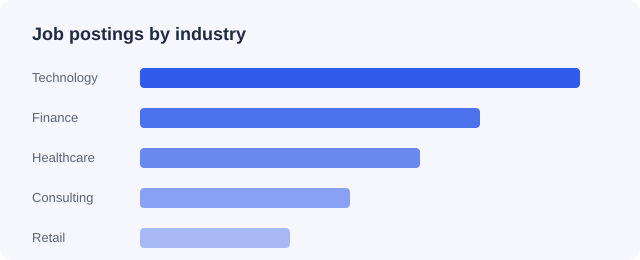
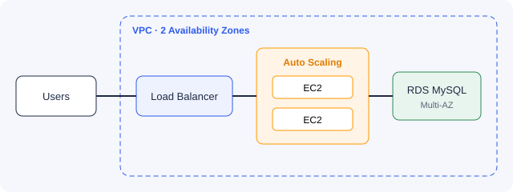

::: {.project-card}
### Labor Market Analysis — Met Career Compass

{fig-alt="Bar chart illustration of job postings by industry"}

Analysis of job-posting data to understand which skills and industries drive demand for analytics roles, with visualizations of the key findings.

[**Tools:** Python, PySpark, Pandas, Quarto]{.tools}

[View on GitHub](https://github.com/AniShaikova){.btn-cta}
:::

::: {.project-card}
### PySpark on AWS EC2

{fig-alt="Diagram of PySpark running on an EC2 instance"}

Set up an Amazon EC2 instance and ran PySpark jobs on a remote Jupyter server.

[**Tools:** AWS EC2, PySpark, Jupyter, VS Code]{.tools}

[View on GitHub](https://github.com/AniShaikova){.btn-cta}
:::

::: {.project-card}
### Scalable Web Architecture on AWS

{fig-alt="Architecture diagram with a load balancer, auto scaling group and database"}

Built a highly available architecture in AWS Academy: VPC, load balancer, Auto Scaling group, and a Multi-AZ RDS database.

[**Tools:** VPC, EC2, Elastic Load Balancing, Auto Scaling, RDS]{.tools}
:::
